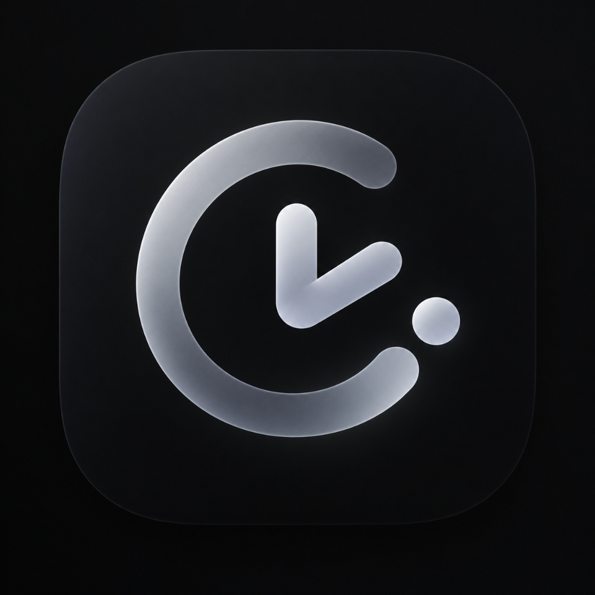

# FOCUS — Personal OS

<div align="center">



### **A Privacy-First, Zero-Cloud Personal Operating System**
*Minimalist Nothing OS Aesthetics × Apple Frosted Glass Squircles*

[](test/)
[](lib/)
[](LICENSE)
[](https://github.com/Jigokunoo26/focus-/releases)

---

### ⬇️ Direct Download Links

| Platform | Direct Download Link | Description |
| :--- | :--- | :--- |
| 🤖 **Android** | [**⬇️ Direct Download APK (Instant)**](https://github.com/Jigokunoo26/focus-/raw/main/releases/FOCUS-Android-v1.0.0.apk) | Direct offline installer (No waiting, ready now) |
| 🪟 **Windows** | [**View Windows Release**](https://github.com/Jigokunoo26/focus-/releases) | Standalone portable bundle (`focus_app.exe`) |
| 🍎 **iOS** | [**View iOS Release**](https://github.com/Jigokunoo26/focus-/releases) | iOS application package for Xcode / Test deployment |

👉 **[View All Releases & Assets](https://github.com/Jigokunoo26/focus-/releases)**


---

</div>

## 🛡️ Privacy & Zero-Surveillance Architecture

**FOCUS Personal OS** is engineered from the ground up to protect your privacy and attention:

- **100% Offline-First Persistence**: Powered by SQLite (`drift`). All tasks, habit logs, focus sessions, and configuration remain solely on your device.
- **Zero Cloud & Zero Telemetry**: No tracking SDKs, no external network requests, no remote logging, and no AI chat servers inspecting your notes. Operates completely in Airplane mode.
- **Safe Digital Wellbeing (Focus Guard)**:
  - Accessibility monitor strictly observes foreground package names without reading screen content (`canRetrieveWindowContent="false"`).
  - No keylogging, no URL scraping, and no screenshot capture.
  - Transparent 30-day auto-purged local audit log.
- **Self-Sovereign Data**: Full 1-tap offline JSON export and restore directly from Settings.

---

## ✨ Core Features

### 1. Critical Alert & Task Engine
- Deterministic 10-state task lifecycle (`PENDING` → `SCHEDULED` → `TRIGGERING` → `TRIGGERED` → `ACKNOWLEDGED` / `SNOOZED` / `DISMISSED` / `COMPLETED` / `FAILED` / `DEAD_LETTER`).
- Atomic outbox persistence pattern: ensures scheduled alerts survive device restarts or unexpected battery saver kills.
- Optimistic revision locking preventing data conflicts.

### 2. Focus Guard (Non-Coercive Digital Wellbeing)
- Intercepts distracting app launches during active focus sessions.
- Always provides **4 immediate, non-punitive exit choices**:
  1. **Accept & Switch** (return to your focus session)
  2. **Snooze 5m** (temporary grace period)
  3. **Emergency Bypass** (instant access when urgently needed)
  4. **Modify Policy** (adjust restrictions anytime)

### 3. Outside-of-App Home Screen Widgets
- Live widgets for your phone's home screen:
  - **Focus Timer Widget**: Start and pause deep work without opening the app.
  - **Tasks Glance Widget**: View pending priority tasks at a glance.
  - **Daily Habits Widget**: Quick check-ins for active streaks.
  - **Daily Overview Widget**: Completion metrics and timeline progress.

### 4. Apple-Grade Squircle Glassmorphism & Nothing OS Monochromes
- High-contrast pure dark mode with custom typography tokens.
- Frosted glass cards with backdrop filtering.
- Fully responsive across compact mobile displays (<360dp) up to desktop resolutions.

---

## 🏗️ Repository Architecture

```text
FOCUS/
├── .github/workflows/       # Multi-platform CI/CD (Android, Windows, iOS)
├── android/                 # Native Android adapter, accessibility service & widgets
├── ios/                     # Native iOS Runner, WidgetKit Swift extension
├── windows/                 # Windows desktop runner & resources
├── assets/icons/            # High-resolution squircle app icons
├── lib/
│   ├── core/                # Design tokens, theme, glass widgets, responsive scaffold
│   ├── data/                # SQLite database, drift DAOs, offline repositories
│   ├── domain/              # Critical alert engine, policy rules, focus coordinators
│   ├── features/            # Feature screens (Dashboard, Focus, Tasks, Habits, Settings)
│   └── platform/            # Native method channels, widget sync, platform alerts
└── test/                    # 23 automated unit, widget, and integration tests
```

---

## 💻 How to Build from Source

### Prerequisites
- [Flutter SDK](https://docs.flutter.dev/get-started/install) (version `3.47.7` or later)
- Dart SDK (`3.13.5` or later)

### 1. Clone & Fetch Dependencies
```bash
git clone https://github.com/Jigokunoo26/focus-.git
cd focus-
flutter pub get
```

### 2. Run Test Suite & Static Analysis
```bash
flutter test
flutter analyze
```

### 3. Build Production Binaries

#### 🤖 Android APK
```bash
flutter build apk --release
```
*Output: `build/app/outputs/flutter-apk/app-release.apk`*

#### 🪟 Windows Desktop
```bash
flutter build windows --release
```
*Output: `build/windows/x64/runner/Release/`*

#### 🍎 iOS Bundle (macOS host with Xcode)
```bash
flutter build ipa --no-codesign
```
*Output: `build/ios/ipa/*.ipa`*

---

## 📄 License
This project is open-source under the [MIT License](LICENSE).
