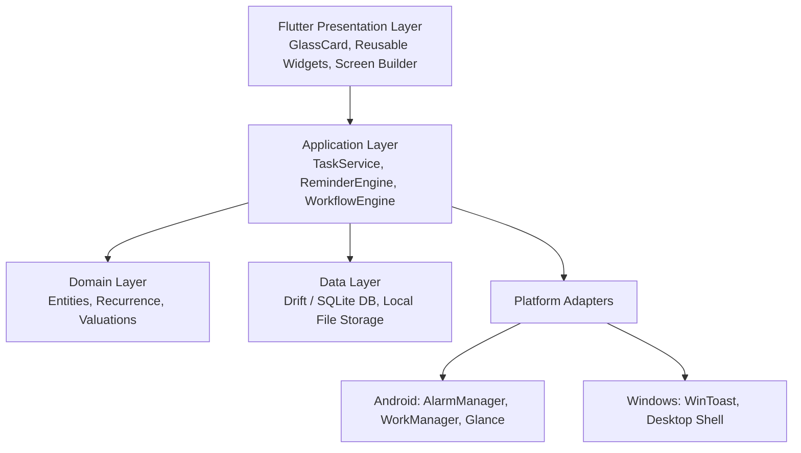
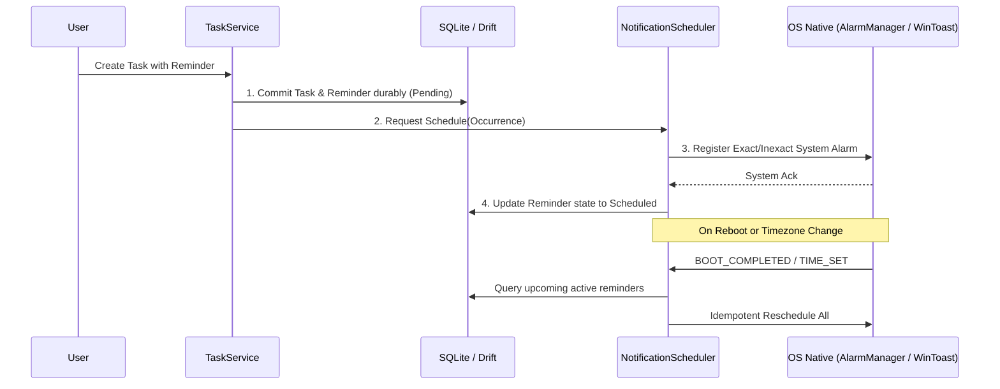

# Personal Productivity OS (FOCUS) — Architecture & Foundation Plan

This architecture plan is derived directly from [master_implementation_plan_personal_os_app.pdf](file:///c:/FOCUS/master_implementation_plan_personal_os_app.pdf) and established development guidelines.

---

## 1. System Overview & Core Principles

- **Local-First & Offline-Only**: Zero cloud dependency, zero required remote accounts, and deterministic local behavior.
- **Deterministic & Non-AI**: No LLM dependencies or AI chat interfaces. Reliable scheduling, explicit date/time rules, and transparent state machines.
- **Aesthetic Direction**: **Nothing OS** minimalism (monochrome palette, dot-matrix cues, high-contrast typography, large clean clocks) fused with **Apple-grade polish** (frosted-glass blur, generous spacing, smooth spring transitions, subtle rounded cards).
- **Multi-Platform**: Flutter + Dart core codebase running natively on **Android** and **Windows Desktop**.



---

## 2. Directory & Repository Layout

Following the clean modular structure defined in Section 5 & 11 of the master plan:

```
c:/FOCUS/
├── android/                   # Native Android configuration, AlarmManager & Glance widgets
├── windows/                   # Native Windows configuration & packaging
├── lib/
│   ├── main.dart              # App bootstrap & global error handling
│   ├── core/
│   │   ├── constants/         # App keys, storage paths, defaults
│   │   ├── design_system/     # Design tokens: palette, typography, radii, blur, glass cards
│   │   ├── router/            # go_router declarative routes
│   │   └── utils/             # Date/time, timezone, recurrence calculators
│   ├── data/
│   │   ├── database/          # Drift database, tables, DAOs, schema migrations
│   │   └── repositories/      # Local repository implementations
│   ├── domain/
│   │   ├── models/            # Immutable models (Task, Event, Reminder, Project, Screen)
│   │   └── repositories/      # Repository interface contracts
│   ├── features/
│   │   ├── dashboard/         # Personal OS home screen & widget grid
│   │   ├── tasks/             # Task CRUD, filters, subtasks, priorities
│   │   ├── calendar/          # Monthly, weekly, and agenda views
│   │   ├── reminders/         # Reminder management, health monitor & permission UX
│   │   ├── projects/          # Projects, milestones, progress tracking
│   │   ├── habits/            # Habit tracker & streaks
│   │   ├── focus/             # Pomodoro / focus timer sessions
│   │   ├── notes/             # Quick capture & notes
│   │   └── screen_builder/    # Dynamic widget layout editor & JSON registry
│   └── platform/
│       ├── notification_scheduler.dart # Abstract interface
│       ├── android/           # Kotlin platform channel bridges
│       └── windows/           # Windows desktop notification adapter
├── test/                      # Unit & integration tests
└── pubspec.yaml               # Managed dependencies
```

---

## 3. Design System Tokens (Nothing OS + Apple Polish)

| Token Type | Value / Specification | Visual Impression |
| :--- | :--- | :--- |
| **Theme Base** | Pure Pitch Black (`#0A0A0B`) & Deep Graphite (`#121214`) | High contrast, OLED-optimized, calm |
| **Glass Surface** | `rgba(255, 255, 255, 0.04)` to `rgba(255, 255, 255, 0.08)` | Subtle translucent frosted layer |
| **Glass Blur** | `ImageFilter.blur(sigmaX: 16, sigmaY: 16)` | Optical depth without performance cost |
| **Card Borders** | `1px solid rgba(255, 255, 255, 0.10)` | Hairline razor edge definition |
| **Accent Hue** | Electric Vermilion (`#FF3B30`) or Signal Amber (`#FF9500`) | Focused, singular accent for active states |
| **Typography** | Monospace/Dot-matrix numerical displays + clean Sans-Serif | Expressive Nothing-inspired metric widgets |
| **Corner Radius** | `18px` – `24px` continuous smooth corners (Squircle) | Modern Apple-style rounded cards |

---

## 4. Local Database Schema (Drift / SQLite)

The schema utilizes transactional SQLite with UUID keys and ISO8601 UTC timestamps:

1. **`tasks`**: `id`, `title`, `description`, `status` (`todo`, `in_progress`, `completed`, `cancelled`), `priority` (0–3), `due_at_utc`, `timezone_id`, `project_id`, `parent_task_id`, `created_at_utc`, `updated_at_utc`, `completed_at_utc`.
2. **`projects`**: `id`, `name`, `description`, `status`, `color_hex`, `icon_name`, `deadline_utc`, `created_at_utc`.
3. **`events`**: `id`, `title`, `starts_at_utc`, `ends_at_utc`, `timezone_id`, `is_all_day`, `location`, `recurrence_rule_id`.
4. **`reminders`**: `id`, `owner_type` (`task`, `event`), `owner_id`, `trigger_at_utc`, `state` (`pending`, `scheduled`, `delivered`, `missed`, `cancelled`), `notification_id` (deterministic int32), `action_state`.
5. **`recurrence_rules`**: `id`, `owner_id`, `frequency`, `interval_val`, `by_weekday`, `end_condition_json`, `timezone_id`.
6. **`screens` & `widgets`**: Versioned JSON schema storing screen configurations, widget placements, grid spans, and parameters.
7. **`habits` & `habit_logs`**: Habit streaks, daily completion records, and notes.
8. **`audit_events`**: Detailed local log of notification delivery, trigger execution, and reconciliation events.

---

## 5. Reminder Reliability Pipeline



---

## 6. Implementation Stages

- [x] **Stage 0**: Requirements analysis and Master Plan review.
- [ ] **Stage 1 (In Progress)**: Setup Flutter SDK, initialize project structure, implement design tokens, Drift database layer, and navigation shell.
- [ ] **Stage 2**: Core Productivity (Task CRUD, Events, Projects, Subtasks, Daily Overview).
- [ ] **Stage 3**: Reminder Engine (AlarmManager, Notification channels, deterministic reconciliation).
- [ ] **Stage 4**: Customization & Screen Builder (Widget registry, layout engine, theme editor).
- [ ] **Stage 5**: Native Platform Integrations (Android widgets, shortcuts, voice capture, Windows notifications).
- [ ] **Stage 6**: Hardening & Release Packaging.
